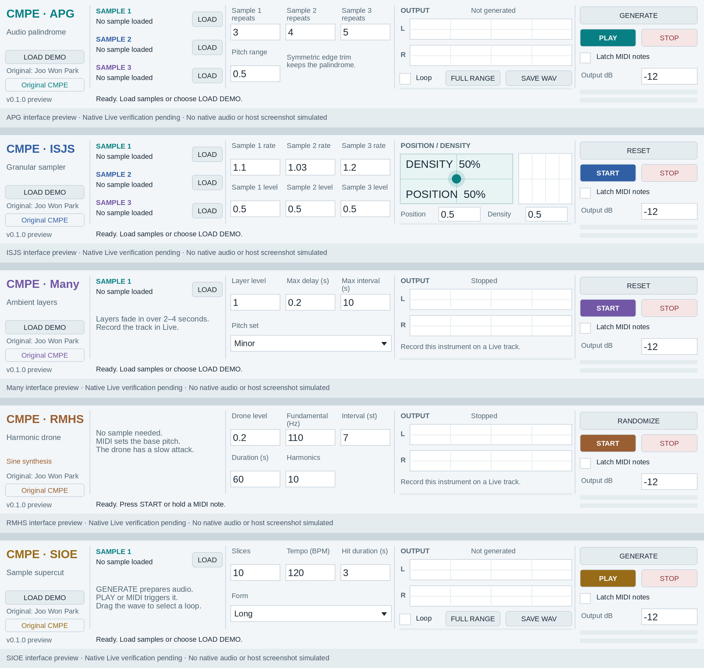
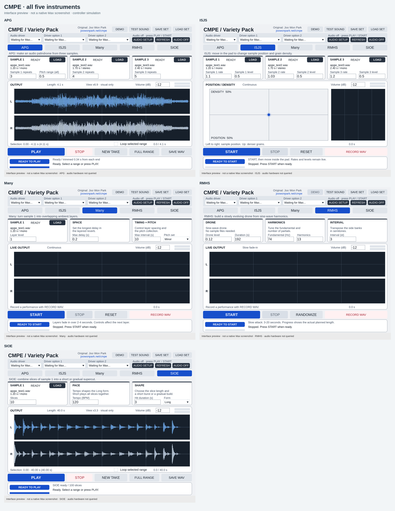
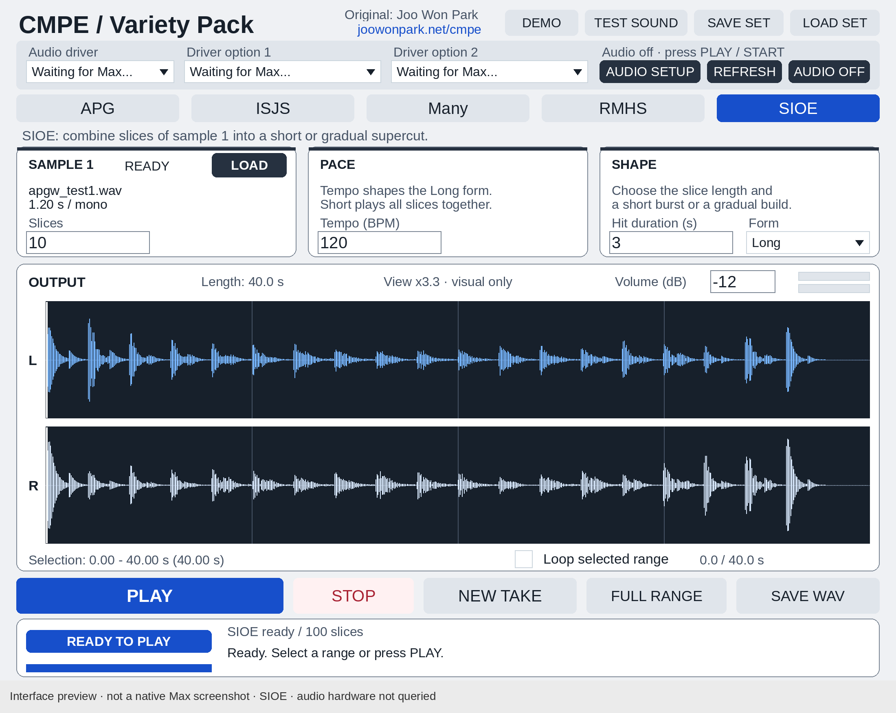
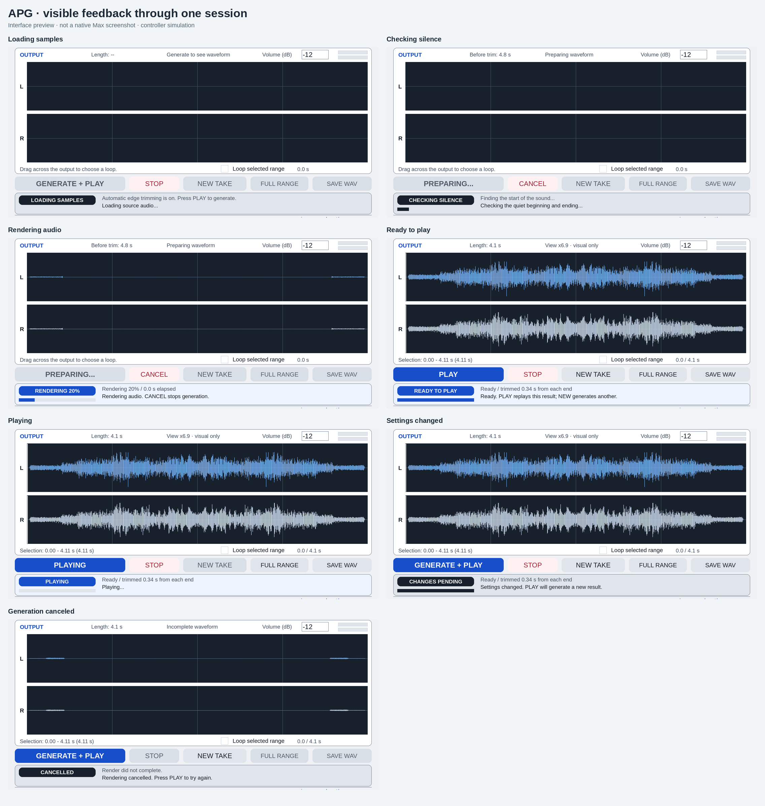

# CMPE Variety Pack for Max

**Max/MSP adaptations of [Joo Won Park’s Computer Music Practice Examples](https://joowonpark.net/cmpe/).** The original musical ideas and SuperCollider algorithms are his. This project brings APG, ISJS, Many, RMHS, and SIOE into one simple interface, extending the existing APG Wave patch.

## Download and open

1. **[Download CMPE for Max](https://github.com/modelcollapse/CMPE-MAXMSP/raw/refs/heads/main/dist/CMPE_Max.zip)**. This is the complete playable **1.3.0** package.
2. Extract the ZIP. Keep the resulting **`CMPE_Max`** folder together.
3. Open **`CMPE_Variety_Pack.maxpat`** in Max.
4. Choose your audio interface in the top audio controls, or open **AUDIO SETUP**. Use **TEST SOUND** to check the output.
5. The three included demo samples load automatically. Choose an instrument and press **GENERATE + PLAY** or **START**. A prepared result shows **PLAY**.

Keep all the files in the extracted folder together. The main patch needs its JavaScript files, voice patches, and demo audio beside it. Downloading only a `.maxpat` file is insufficient. Downloading the ZIP does not open it in Max; extract it first.

The package includes **[START_HERE.html](START_HERE.html)**. The main file keeps the same name across updates: **`CMPE_Variety_Pack.maxpat`**. [Download the full source repository](https://github.com/modelcollapse/CMPE-MAXMSP/archive/refs/heads/main.zip) for developer tools, the retained standalone APG, and the separate Max for Live preview.

The collection is designed for **Max 8 or Max 9**, using stock Max/MSP objects and the legacy `js` object. No third-party externals, Node.js, or Python are required to play it. Close older copies before opening this version. Use **TEST SOUND** to check Max’s selected audio output.

**Native Max was unavailable during development.** The models, rendered samples, controller behavior, and patch connections have automated checks; actual Max object loading, audible output, mouse interaction, and disk recording still require verification in Max. See [validation details](developer/CMPE_VALIDATION.md).

## CMPE Current edition (Tape + Memory)

**[`cmpe-current/`](cmpe-current/)** is the latest standalone edition, tested live in Max 9. Open **`cmpe-current/CMPE_CURRENT.maxpat`** and keep that folder together.

It adds to the five instruments:

- **Tape + Memory:** a shared effects chain with processed WAV recording.
- **Sample loading:** drag and drop, more reliable loading, and Match levels.
- **Theory presets and guidance:** for ISJS, Many and RMHS, including just intonation, harmonic series and live interval readouts.
- **ADVANCED panels:** for every instrument, with variation lock.
- **Looping sample preview.**
- **Per-instrument gain:** about 12–18 dB louder than before by default.
- **An accessible light theme** that meets WCAG AA contrast.

See [cmpe-current/README.md](cmpe-current/README.md) for the full change log and [cmpe-current/docs/CMPE_USAGE.md](cmpe-current/docs/CMPE_USAGE.md) for usage.

## Max for Live edition

The **[Max for Live 0.1.0 preview](max-for-live/README.md)** contains five separate `.amxd` instruments for Ableton Live: APG, ISJS, Many, RMHS, and SIOE. Each has a compact horizontal interface, MIDI triggering, Live parameter integration, and stereo output through its track. APG and SIOE separate generation from playback and preserve the generation seed for reconstructing saved results.

Download the [complete source repository ZIP](https://github.com/modelcollapse/CMPE-MAXMSP/archive/refs/heads/main.zip), then keep the **entire `max-for-live` folder** together and drag an `.amxd` file onto an empty MIDI track. These are unfrozen devices with adjacent dependencies. **Native Live loading, audio, saved-Set recall, and offline rendering still require host testing.** The standalone Max download above contains the five-instrument Max patch; the compact Max for Live devices are a separate edition.

[Installation and operation](max-for-live/README.md) · [Native Live checks](max-for-live/NATIVE_LIVE_CHECKS.md)



## Choose your audio interface

The top row contains **Driver** and two option menus supplied by the selected Max driver. Their labels come from Max: a driver may expose **Input Device** and **Output Device**, while another driver exposes different options. Choose the interface in the menu bearing the appropriate label. No particular hardware names or device numbers are built into the patch.

**AUDIO SETUP** opens Max's full Audio Status window for device settings, sample rate, buffer size, and output-channel mapping. Use **REFRESH** after connecting an interface or changing settings in that window. The audio button and status text show Max's reported on/off state.

Changing a driver or device, or opening AUDIO SETUP, stops this patch's playback and recording first and turns Max audio off. Press PLAY/START or use the audio power button when the new interface is ready. Audio settings apply to Max and are not stored in the musical **SAVE SET** files.

The interface uses a neutral light background, white source cards, and dark text. The selected instrument and primary action change color with the mode: APG blue, ISJS teal, Many purple, RMHS copper, and SIOE rose. **LOAD** buttons have solid charcoal backgrounds and bold white labels. Rounded buttons and dark waveform panels separate the controls from the audio displays. State labels remain explicit alongside color.

## Five instruments

| Instrument | What it does | Sources | How it starts |
| --- | --- | --- | --- |
| **APG** | Generates an audio palindrome with matching forward and backward halves | Three samples | Renders a waveform, then plays |
| **ISJS** | Granulates samples; move in the pad to change position and density | Three samples | Starts live |
| **Many** | Builds overlapping pitched layers through seven stereo allpass stages | Sample 1 | Starts live, with 2–4 second fades |
| **RMHS** | Generates an evolving drone from sine-wave harmonics | No samples | Starts live, with 3–20 second attacks |
| **SIOE** | Combines slices into a short supercut or a gradually growing and shrinking sequence | Sample 1 | Renders a waveform, then plays |

Only the source controls needed by the selected instrument are shown. Use **LOAD** to choose mono or stereo WAV/AIFF files while stopped. **DEMO** reloads the included synthetic samples.

### Record into a sample buffer

Choose your input device in the top audio controls or **AUDIO SETUP**, then press **REC IN** on the sample slot you want to replace. It records the selected device's input channels 1 and 2 into a stereo buffer, for up to 60 seconds. Press the same button again or **STOP** to finish the take. The old sample remains available until the stopped recording has been checked and adopted.

The recorded sample can be used immediately in APG or ISJS, or in sample 1 for Many and SIOE. Each source card has a small waveform independent of the large generated-output display. Recording starts only when you press REC IN. The raw input is not routed to the listening output.

Use the sample card's **SAVE** button to write its new recording as a 24-bit WAV. **SAVE SET** requires these recordings to be saved first, because settings files store sample paths. Changing modes, loading settings, changing audio devices, or losing the audio engine cancels an unfinished input take and preserves the previous source.

ISJS and Many continue until stopped. RMHS finishes automatically after its planned voices fade out. Its displayed duration includes the slow attacks and releases, so it can exceed the duration setting. Many and RMHS identify their fade-ins in the status area.

## Interface previews

Version **1.3.0** corrects the native waveform zoom direction: quiet output now receives a smaller native amplitude range, making the trace taller. This changes the display only. Small source waveforms show loaded or recorded samples before a composition is generated. APG repeat maxima and pitch range have larger number fields and adjacent minus/plus buttons. Attribution to Joo Won Park is visible at the bottom.

The stereo waveform and live-scope areas remain **144 pixels high per channel**. The complete interface is **1100 × 900**. ISJS's position/density pad and adjacent scope remain 298 pixels high. Loop selection stays below the waveform; playback, FULL RANGE, and SAVE WAV share the transport row.

These images are rendered from the shipped Max patch layout and its controller state. APG and SIOE show output generated from the included demo sounds by the production renderer. They are **interface previews, not native Max screenshots**; live instruments are shown stopped. Device menus show fallback placeholders because no physical audio hardware was queried for these images.



### APG: audio palindrome


### ISJS: position and density pad


### Many: ambient sample layers


### RMHS: harmonic drone


### SIOE: rendered audio supercut



## Common controls

| Control | Behavior |
| --- | --- |
| **Driver / device options** | Select an available Max audio driver and the options it exposes. |
| **AUDIO SETUP / REFRESH** | Open Max's complete audio settings, or read the current device lists and state again. |
| **Audio on/off** | Enable or disable Max audio; switching off also stops this patch's playback and recording. |
| **REC IN / sample SAVE** | Capture audio input into a sample slot, then save the captured source as a WAV. Press REC IN again or STOP to finish. |
| **Repeat − / +** | Change an APG sample's repeat maximum by one, within 1–20. The large number field also accepts direct entry. |
| **Pitch − / +** | Change APG's random pitch range by 0.1, within 0–1. Direct entry remains available. |
| **GENERATE + PLAY / PLAY / START** | Explains whether APG/SIOE needs generation, replays a prepared result, or starts a live instrument. The button shows PREPARING, PLAYING, or LIVE while active. |
| **STOP / CANCEL** | Stops playback, cancels generation, clears live tails and scheduled events, and ends recording. |
| **NEW TAKE** | Generates another APG/SIOE result and leaves it ready to play. |
| **RESET / RANDOMIZE** | Restores ISJS/Many defaults, or chooses new RMHS starting controls, while stopped. |
| **Waveform** | APG/SIOE: drag across either channel to select a playback range. Quiet waveforms are automatically enlarged for display; the labelled view scale never changes audio level. |
| **Loop selected range / FULL RANGE** | Repeat the selected range, or restore the full finite result. |
| **Live scopes** | Show the current signal in ISJS, Many, and RMHS. |
| **Volume (dB)** | Changes listening volume. It does not change exported or recorded audio. |
| **SAVE SET / LOAD SET** | Save or restore instrument settings and source paths in a JSON file. |

Changing instruments stops the previous one and its recording. ISJS rates, levels, and position/density pad remain editable during playback. Many controls affect new layers. RMHS controls are locked until its performance stops.

### Read the activity state

The badge beside the transport reports **LOADING SAMPLES**, **CHECKING SILENCE**, **RENDERING**, **READY TO PLAY**, **PLAYING**, or **LOOPING**. The progress bar uses actual scanned frames, rendered frames, or playback position. Each phase is labelled separately; no completion estimate is fabricated. The detail text includes elapsed time or the current task.

**CHANGES PENDING** means the visible waveform belongs to the previous settings. **GENERATE + PLAY** creates the updated result. A cancelled or failed render is labelled **CANCELLED** or **RENDER ERROR**, and the partial waveform is not presented as a playable result.

Live instruments report **FADING IN**, **LIVE**, **RECORD ARMED**, **RECORDING**, or **COMPLETE** as appropriate. Continuous performances have no invented completion percentage. Stalled sample reads and failed recording notices remain visible; successful late sample loading clears its earlier notice. Unavailable controls are visibly muted.



Playback shows a moving playhead and time. A remaining quiet opening in a rendered result is identified with a countdown to the first sound. The automatic waveform view scale is capped at 64× and is a display setting only; playback, recording, and exported samples retain their actual levels.

## Save audio

**APG and SIOE:** choose **SAVE WAV** after generation. This exports the complete cached stereo result as a 24-bit WAV. The selected loop does not limit the export.

**ISJS, Many, and RMHS:** choose **RECORD WAV** and a destination. While stopped, this arms recording for START. During a performance, it begins recording after you choose the file. **STOP REC** ends recording while the instrument continues; STOP or a mode change ends both.

Live recording is taken before the listening-volume control. Use the instrument’s source, layer, or drone levels to change the recorded level. The test tone is excluded. A settings file contains source paths and controls; it does not embed audio, a rendered result, or random seeds.

## APG’s silence trimming

APG removes long quiet edges while preserving the palindrome. An opening of at least **250 ms** is shortened to approximately **25 ms** before the first sample above **−100 dBFS** in either channel. The same number of samples is removed from the end. Internal pauses remain. An entirely silent or subthreshold result keeps its length and receives a status message.

Waveform, playback, loop selection, and export all use the trimmed result. SIOE uses its own supercut structure and does not apply APG’s symmetric trimming.

## Standalone APG Wave

**`APG_Wave.maxpat`** remains the standalone APG Wave version 5. Its audio engine and controls are unchanged by this extension. Open it if you only want the palindrome generator.

- [CMPE collection: complete usage and troubleshooting](docs/CMPE_USAGE.md)
- [Standalone APG Wave: usage and troubleshooting](docs/USAGE.md)
- [Original-project attribution and implementation provenance](ATTRIBUTION.md)
- [Change history](CHANGELOG.md)

## Project files

| File or folder | Purpose |
| --- | --- |
| `CMPE_Variety_Pack.maxpat` | Main five-instrument collection to open in Max |
| `cmpe_variety.js` | Complete controller and finite-rendering runtime |
| `cmpe_xy.js` | ISJS position/density pad |
| `cmpe_sample_voice.maxpat` | Live sample voice for ISJS |
| `cmpe_many_voice.maxpat` | Ambient layer and allpass network for Many |
| `cmpe_drone_voice.maxpat` | Harmonic voice for RMHS |
| `APG_Wave.maxpat`, `apg_wave.js` | Preserved standalone APG Wave |
| `apgw_test1.wav`, `apgw_test2.wav`, `apgw_test3.wav` | Synthetic demonstration sounds |
| `developer/` | Source modules, patch builders, and automated checks |
| `docs/` | Operating instructions |
| `START_HERE.html` | First-use guide with the exact main file and playback steps |
| `dist/CMPE_Max.zip` | Complete current standalone Max package, with one clearly named root folder |

## Development

Run these commands from the repository’s root folder. Python 3 builds the patch files; Node.js runs the automated checks.

```sh
python3 developer/build_apg_wave.py
python3 developer/build_cmpe_voices.py
python3 developer/build_cmpe_variety.py

node developer/validation/test_apg.js
node developer/validation/test_render.js
node developer/validation/test_wave_controller.js
node developer/validation/test_cmpe_model.js
node developer/validation/test_cmpe_controller.js
node developer/validation/test_cmpe_controller.js --bundle
node developer/validation/test_cmpe_ui.js
node developer/validation/test_cmpe_input_recording.js
python3 developer/build_cmpe_previews.py
python3 developer/package_cmpe.py
```

Edit the separate modules in `developer/`, then rebuild and reopen the patch. Editing only a generated runtime will lose the change on the next build. The controller tests simulate Max buffers, tasks, files, UI objects, and messages; they do not run the native audio engine.

To regenerate the interface previews, run `python3 developer/build_cmpe_previews.py`. This documentation step requires Python's Pillow package and Node.js. It renders the current patch layout and production controller state, including demo-audio output for APG and SIOE.

See [CMPE implementation and validation](developer/CMPE_VALIDATION.md) for the source mappings, intentional DSP differences, resource limits, completed checks, and remaining native acceptance work. The [APG validation record](developer/VALIDATION.md) covers the retained palindrome engine.

## Original project

**Original CMPE instruments and SuperCollider algorithms: Joo Won Park.** His [CMPE project page](https://joowonpark.net/cmpe/) links the original instruments, code, explanations, and Variety Pack. The [original APG page](https://joowonpark.net/apg/) provides its app and source and requests proper credit when the idea is used in another project. Both Max entry points include visible credit and a link to the original work.
