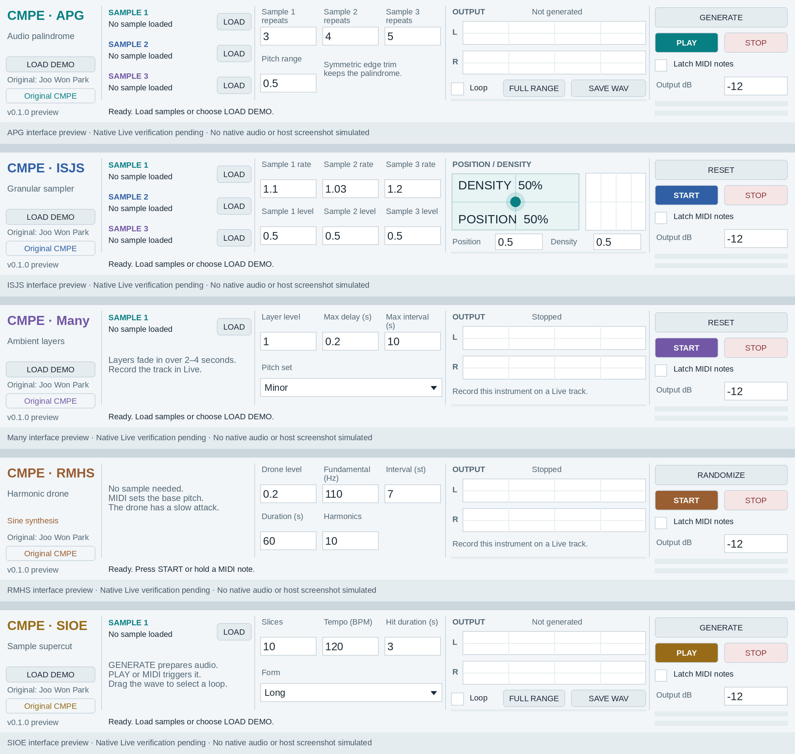

# CMPE Max for Live

**Five Max for Live instruments, adapted from [Joo Won Park's Computer Music Practice Examples](https://joowonpark.net/cmpe/).**

Version **0.1.0 preview**, November 21, 2026. This package contains actual unfrozen `.amxd` device files and their adjacent dependencies. The automated checks cover the file containers, patch connections, controller behavior, and finite audio rendering. **Opening and listening in Ableton Live remain to be verified in a native Live installation.**

## Install and open

1. Download the complete ZIP and extract it. Keep the extracted folder together.
2. Move the whole folder somewhere permanent, such as `Music/CMPE_Max_for_Live` in your home folder. This is a suggested destination; downloading the ZIP does not move it there automatically.
3. Open Ableton Live with Max for Live enabled. Add the extracted folder under **Places** in Live's browser, or locate it in Finder / File Explorer.
4. Drag one of the five **`.amxd` files onto an empty MIDI track**. Use the `.amxd` file for Live; the matching `.maxpat` is an editable source copy.
5. Set your audio interface and output in **Live's Audio settings**. Each device sends stereo audio through its own Live track.

Max for Live is included in Live Suite and is available for Live Standard with the Max for Live add-on. See [Ableton's setup instructions](https://www.ableton.com/en/manual/max-for-live/).

These devices use stock Max/MSP objects and legacy JavaScript. Python and Node.js are development tools only; they are not required to play the devices. The JavaScript, voice patches, and demo WAV files must stay beside the `.amxd` files. This release uses a complete folder instead of a frozen single-file distribution.

## Choose an instrument

| Device | Sound | Samples | First action |
| --- | --- | --- | --- |
| **APG** | An audio palindrome with mirrored forward and backward events | Three | Load sources or DEMO, GENERATE, wait for Ready, then PLAY |
| **ISJS** | Granular textures with position and density controls | Three | Load sources or DEMO, then START |
| **Many** | Overlapping ambient layers through allpass filters | Sample 1 | Load a source or DEMO, then START; layers fade in over 2–4 seconds |
| **RMHS** | Harmonic sine drones with slowly changing pitch | None | START; the partials fade in over 3–20 seconds |
| **SIOE** | A short or gradually changing supercut | Sample 1 | Load a source or DEMO, GENERATE, wait for Ready, then PLAY |

RMHS is the simplest first check because it does not need a sample file. Its slow attack is part of the composition. For the sample-based devices, LOAD accepts mono or stereo WAV/AIFF files. DEMO uses the included synthetic samples.

On a fresh device, the required demo sources load automatically. A restored Live Set uses its saved source references. LOAD DEMO deliberately replaces the current sources with the included examples.

## Generate, play, and loop

APG and SIOE prepare their audio before playing. **GENERATE** creates a new result and shows rendering progress. **PLAY** and MIDI notes only play a prepared result. They do not silently start a long render. If generation is still running, wait for Ready and trigger again; a note sent during generation is not queued for later playback.

Drag across either output waveform to choose a range. Enable LOOP to repeat that selection; use the full-range control to restore the whole output. The two waveform channels share the selection. SAVE WAV exports the complete prepared result as a 24-bit stereo WAV, including audio outside a selected loop.

APG retains its symmetric silence trimming: long quiet edges are shortened by the same amount at both ends so the palindrome remains intact. Internal pauses remain. SIOE keeps its own supercut timing.

## MIDI and performance

Arm the MIDI track or set its MIDI monitoring as appropriate to receive notes. Manual PLAY/START is also available. MIDI velocity controls the device's output level. RMHS uses the incoming note as its fundamental pitch; the other four use notes to trigger their texture or prepared result.

The MIDI latch control lets a performance continue after note release. With latch off, releasing the active note stops the MIDI-triggered performance. STOP always ends the current performance. Manual START is useful for long ambient performances without holding a key. These are whole-performance triggers, not a separate copy of the entire composition for each MIDI note.

ISJS's rates, levels, position, and density remain editable during playback. Many's controls affect newly created layers. APG/SIOE generation settings can change during playback, but the current audio continues unchanged and a new GENERATE is required before another trigger. RMHS structural edits apply to the next performance. Parameters have stable names within each device for Live automation and mapping; the devices do not switch instruments inside a shared parameter bank.

## Saving a Live Set

The host adapter stores the musical controls, source references, loop settings, and MIDI latch state through Live's parameter system. For a prepared APG/SIOE result, it also records the random seed and original render sample rate. On restoration it can rebuild the result from the same samples, showing progress and remaining silent until you trigger playback.

**Your custom audio files remain external.** Keep them in a stable location, preferably with the Live project. This device does not implement automatic sample collection or rewrite custom paths when a project moves. If a file moves, use LOAD to select it again. Included demo references are resolved relative to the installed device folder.

Reconstruction checks source length, channel count, and duration. It cannot detect every edit to a file that retains those properties. Keep the original source audio unchanged, and use SAVE WAV to preserve an exact finite result independently of its sources. Live instruments generate a new live performance when started; their evolving voice history is not saved as audio.

## Recording and timing

Record the instrument's Live track output to an audio track when you want to keep a live performance. Track output includes the device's volume and MIDI velocity. APG/SIOE's SAVE WAV exports the prepared buffer before those playback-level controls.

This preview preserves the original generators' free-running timing. SIOE's tempo belongs to its generated composition; changing Live's tempo does not stretch an already prepared waveform. The devices do not add automatic beat quantization or transport following.

The live generators currently schedule control events with JavaScript tasks and wall-clock timing. Native offline export and Freeze Track behavior need specific testing. For a dependable capture workflow during this preview, record the output in real time and check the resulting audio. Freezing a **device** to package dependencies is a separate operation from freezing a **track** to render audio.

## If there is no sound

Check the device status first. APG/SIOE need to say Ready; a render or restoration is not yet a playable result. ISJS and Many need source files. Many and RMHS have deliberate slow fade-ins.

Check that Live's audio engine is running, the device and track are enabled, the track is routed to an audible output, and volume is raised. For keyboard input, check track arming and monitoring. A momentary note can end a slowly fading sound before it becomes audible; hold the note or use MIDI latch / manual START.

If the Max Console reports a missing JavaScript or voice patch, restore the complete extracted folder. A single `.amxd` copied away from its dependencies is incomplete. If a source read fails, check the path and file format; removing and reloading the device clears a native read that never finishes.

## Verification and source

See **NATIVE_LIVE_CHECKS.md** for the remaining native checks and **VALIDATION.md** for completed automated checks. The interface previews show generated patch layouts; they are labelled previews, not screenshots captured in Ableton Live.

The reproducible builders, modular JavaScript, and tests live in the [CMPE-MAXMSP repository](https://github.com/modelcollapse/CMPE-MAXMSP). The standalone Max collection remains available separately in that repository.

## All five interface previews

Open **START_HERE.html** for an illustrated local installation guide. The overview below keeps all five device layouts visible together.

Original musical ideas and SuperCollider algorithms: **Joo Won Park**. [Original CMPE collection](https://joowonpark.net/cmpe/) · [Original Audio Palindrome Generator](https://joowonpark.net/apg/). See ATTRIBUTION.md for provenance and terms.
